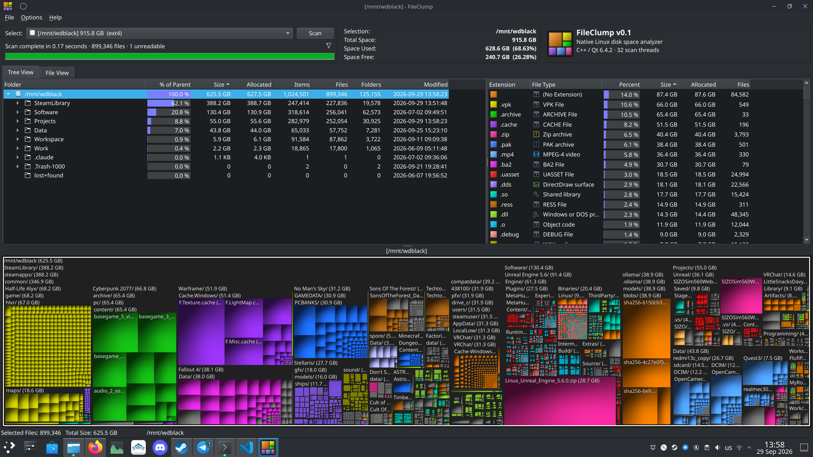

# FileClump

A native, lightweight Linux disk space analyzer in the tradition of SequoiaView, WinDirStat and WizTree:
a folder tree, an extension breakdown, and a squarified, cushion-shaded treemap where
each file is a block sized by bytes and coloured by extension.

C++20 + Qt 6 Widgets. ~450 KB binary, no Electron / web runtime.



> FileClump is an independent project and is not affiliated with any of the tools that inspired it.
> See [Credits & inspiration](#credits--inspiration).

## Build

```sh
sudo apt install qt6-base-dev cmake g++     # Debian/Ubuntu/Kubuntu
cmake -S . -B build -DCMAKE_BUILD_TYPE=Release
cmake --build build -j
./build/fileclump            # or: ./build/fileclump /path/to/scan
sudo cmake --install build       # optional: installs binary + .desktop entry
```

To see every directory (e.g. `/root`, `/var/lib/...`), run it as root: `sudo -E ./build/fileclump /`.

## Using it

- **Treemap**: hover a block for its name, size and path. Click it to select that item in the tree. Double-click to drill into a folder. Backspace or mouse-back zooms out. Right-click opens the context menu.
- **Tree View**: sizes, % of parent, allocated size, file/folder counts, modified time. A folder's files are grouped under a `[N Files in …]` row.
- **Extension list**: select one or more extensions and every other block on the map is dimmed.
- **File View**: every file, largest first. Filter by substring or wildcard (`*.mp4`); include `/` in the filter to match the full path.
- **Context menu**: Open, Explore Folder, Terminal Here, Scan This Folder, Copy Path, Export CSV, Zoom, Move to Trash, Delete.
- **Help menu**: *Visit GitHub* opens the project page. *About FileClump* (F1) opens a window with the full help, credits and license text.
- **Options**: allocated vs apparent size on the treemap, names on the treemap, stay on one filesystem, count hard links once.

## How it's fast

- `statx()` on a pool of 2×cores threads (max 32), using a shared LIFO work stack.
- Each 64-byte node lives in a per-thread bump arena, and a folder's children are stored contiguously.
- Mount points are detected via `stx_mnt_id`. Virtual filesystems (`/proc`, `/sys`, …) are never entered.
- The treemap is rasterised straight into a `QImage`. Layout skips anything smaller than a pixel.

Measured on NVMe, warm cache: 2.5M files in about 0.9 s, with about 380 MB peak RSS.

## Authors

**Original developers (v0.1)**

- **David Eichendorf** ([@Dev1lroot](https://github.com/Dev1lroot)): project author; idea, design direction and testing
- **Claude** (Anthropic, Claude Opus 5.5 via Claude Code): implementation of the initial version

**Contributors**: see [AUTHORS.md](AUTHORS.md). Bug fixes and new features are welcome; read
[CONTRIBUTING.md](CONTRIBUTING.md) first and add yourself to the list in your pull request.

## Credits & inspiration

FileClump builds on ideas from a long line of treemap-based disk usage tools and research:

- **Treemaps**: invented by Ben Shneiderman (University of Maryland, 1991).
- **SequoiaView**: Technische Universiteit Eindhoven. Introduced cushion-shaded treemaps
  (Jarke J. van Wijk and Huub van de Wetering, 1999) and the squarified layout (Bruls, Huizing and van Wijk, 2000).
- **[WinDirStat](https://windirstat.net)**: Bernhard Seifert, Oliver Schneider and contributors.
  Popularised the directory tree + extension list + coloured treemap layout.
- **[WizTree](https://diskanalyzer.com)**: a product of **Antibody Software Limited**. Showed how fast such a tool can be.

All names and trademarks above belong to their respective owners. FileClump is an independent project. It is
**not affiliated with, endorsed by, or connected to** any of these projects or their authors, including Antibody
Software Limited. It contains none of their code, binaries, logos or other assets; everything was written from
scratch for Linux. FileClump is free software. It is not sold and has no paid edition.

## License

Copyright (C) 2026 David Eichendorf and FileClump contributors.

This program is free software; you can redistribute it and/or modify it under the terms of the
**GNU General Public License version 2 only** (`GPL-2.0-only`) as published by the Free Software Foundation.
It is distributed WITHOUT ANY WARRANTY. See [LICENSE](LICENSE) for the full text.
